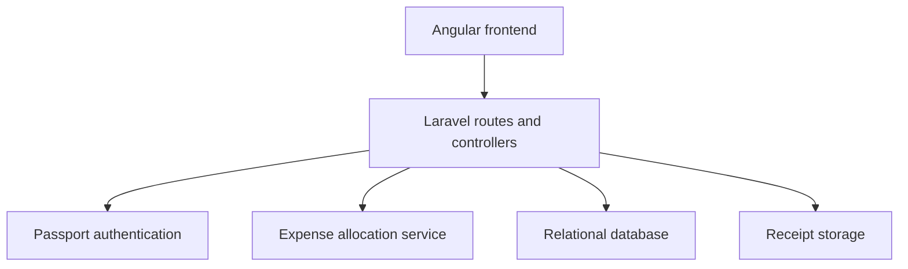

# EvenUpEZ | Group expense management

A personal full-stack application for recording shared expenses, managing groups and attaching receipts. The Laravel API is paired with an [Angular frontend](https://github.com/waleedmazhar64/evenupEZ-frontend).

## Start with the engineering example

The proposed implementation is in [PR #2](https://github.com/waleedmazhar64/evenupEZ-backend/pull/2). [CI passed on PHP 8.2 and 8.3 for commit 50f3c6e](https://github.com/waleedmazhar64/evenupEZ-backend/actions/runs/40807398091): 234 isolated money checks plus three authenticated HTTP/database tests (12 assertions) per PHP version.


[Keeping every penny in an expense split](docs/expense-allocation-case-study.md) follows a real defect from reproduction to a proposed fix: splitting 10.00 three ways must total 10.00.

| Review question | Code or evidence |
| --- | --- |
| How are remainder pennies allocated? | [ExpenseSplitter](app/Domain/Expenses/ExpenseSplitter.php) |
| How does the API validate and persist a split? | [ExpenseController](app/Http/Controllers/ExpenseController.php) |
| What happens with invalid input? | [HTTP and database tests](tests/Feature/ExpenseAllocationTest.php) |
| Do totals remain correct across different values? | [Regression and invariant checks](tests/Smoke/expense_split_checks.php) |
| Has this exact change passed automated checks? | [GitHub Actions runs](https://github.com/waleedmazhar64/evenupEZ-backend/actions) |

## Implemented areas

- Authentication using Laravel Passport.
- Group creation and invitation workflows.
- Equal and custom expense splits.
- Group comments and receipt uploads.
- REST endpoints consumed by the frontend.

## Architecture



## Local setup

PHP 8.2+ and Composer are required. Exact locked dependencies are in `composer.lock`.

```bash
git clone https://github.com/waleedmazhar64/evenupEZ-backend.git
cd evenupEZ-backend
composer install
cp .env.example .env
php artisan key:generate
```

Set up a disposable database in `.env`, then:

```bash
php artisan migrate
php artisan passport:keys
php artisan passport:client --personal
php artisan serve
```

Use the frontend's instructions for its API base URL. Do not commit local environment values or generated keys.

## Run the focused checks

The money checks run without Composer or a database:

```bash
php tests/Smoke/expense_split_checks.php
```

After installing dependencies, run the authenticated HTTP/database regressions against an isolated database:

```bash
DB_CONNECTION=sqlite DB_DATABASE=:memory: php artisan test --filter=ExpenseAllocationTest
```

The workflow checks PHP 8.2 and 8.3. Inspect the run associated with the commit before describing checks as passing.

## Scope

This is a personal project and an inspectable engineering sample. The allocation improvement does not establish production scale or whole-application security. Use synthetic demo data; review object-level access controls and receipt privacy before a public deployment. The [case study](docs/expense-allocation-case-study.md) records the implementation trade-offs and AI assistance.
